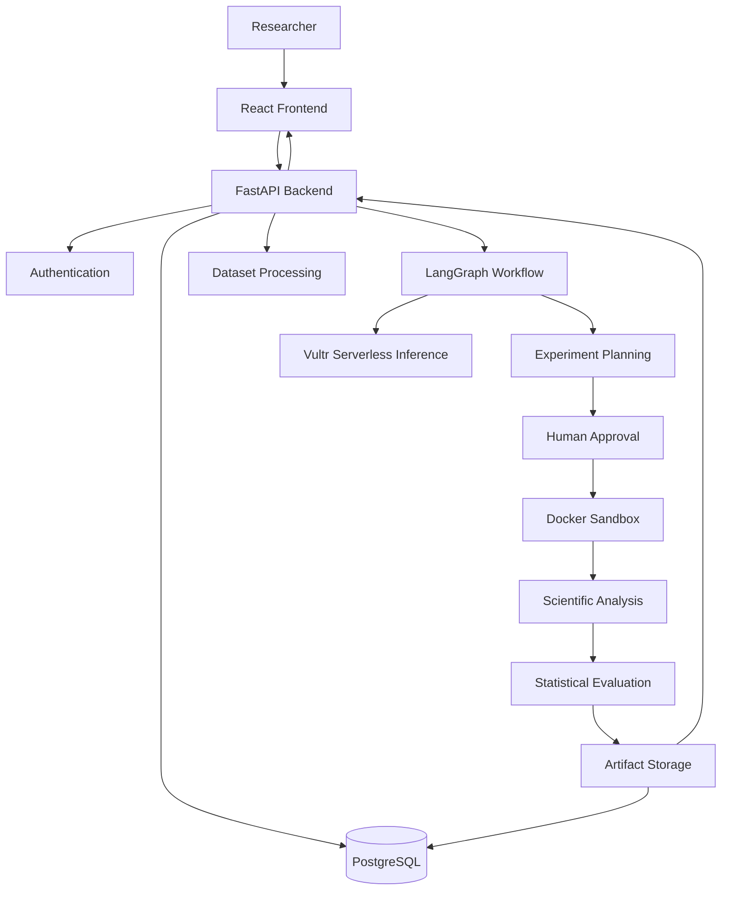

# 🧬 NeuroForge AI
### Autonomous Scientific Discovery & Experimentation Platform

**Transforming scientific datasets into structured, evidence-driven research insights through AI-assisted experimentation.**

<p align="center">
  
  
  
  
  
  
  
</p>

<p align="center">
  <a href="https://neuroforgeai.duckdns.org/">Live Application</a> •
  <a href="https://neuroforgeai.duckdns.org/docs">API Documentation</a> •
  <a href="https://github.com/BakhtawarTasawar/NeuroForge-AI-Vultr-Agent-Rush">Personal Repository</a>
</p>

---

## 🔬 Overview

NeuroForge AI is an autonomous scientific discovery and experimentation platform designed to assist researchers in transforming raw scientific datasets into structured research insights.

The platform integrates AI-assisted hypothesis generation, experiment planning, human approval, isolated analytical execution, statistical evaluation, and evidence-backed reporting into a unified research workflow.

Its initial focus is cancer gene-expression and transcriptomic research datasets.

Rather than functioning as a conventional AI chatbot, NeuroForge AI aims to support a structured scientific workflow in which AI assists with research reasoning while analytical execution remains controlled, reproducible, and reviewable.

**Core principle:** AI should accelerate scientific exploration without compromising analytical control, reproducibility, or scientific integrity.

## 🎯 The Problem

Scientific research frequently involves several disconnected and time-consuming activities:

- Understanding unfamiliar scientific datasets.
- Identifying missing values and data-quality issues.
- Developing research hypotheses.
- Designing appropriate experiments.
- Executing analytical code safely.
- Evaluating results using statistical methods.
- Translating analytical outputs into understandable research reports.

AI can help simplify these processes, but unrestricted code execution and unsupported AI-generated conclusions introduce additional risks.

NeuroForge AI addresses these challenges through an integrated, human-supervised research workflow.

## ⚙️ Key Features

### 1. Dataset Inspection
- Scientific dataset parsing and structural analysis.
- Column and data-type identification.
- Missing-value assessment.
- Dataset-quality evaluation.
- Preparation of structured dataset information.

### 2. AI-Assisted Hypothesis Generation
The research agent uses dataset context to identify potential research directions and distinguish between:

- Observed facts.
- Computationally detected patterns.
- Research hypotheses requiring further investigation.

### 3. Experiment Planning
The platform helps organize analytical experiments by identifying relevant variables, potential methods, statistical requirements, and expected outputs.

### 4. Human-in-the-Loop Approval
Research plans undergo human review before analytical execution, establishing a controlled boundary between AI-generated plans and code execution.

### 5. Isolated Analytical Execution
Docker-based sandboxing introduces multiple execution restrictions:

| Security Control | Configuration |
|---|---|
| Network access | Disabled |
| Root filesystem | Read-only |
| Privilege escalation | Disabled |
| Linux capabilities | Dropped |
| Process limit | 64 |
| Memory limit | 1024 MB |
| CPU limit | 1 CPU |
| Container user | Non-root UID 10001 |
| Container lifecycle | Automatically removed |

Additional safeguards include execution time limits, restricted workspaces, artifact validation, and cleanup.

### 6. Statistical Evaluation
The statistical analysis engine includes:

- Welch's t-test.
- Benjamini-Hochberg correction.
- Hedges' g effect size.
- Principal Component Analysis (PCA).

### 7. Research Findings and Reporting
Experiment outputs are organized into structured findings, including research hypotheses, experiment configurations, statistical results, supporting evidence, and generated artifacts.

## 🏗️ System Architecture

NeuroForge AI uses a modular frontend/backend architecture integrated with an AI research workflow, persistent database, and isolated execution environment.



### Architecture Components

| Component | Responsibility |
|---|---|
| React | User interface |
| TypeScript | Frontend development |
| FastAPI | Backend services |
| LangGraph | Research-agent workflow |
| Vultr Serverless Inference | LLM inference |
| PostgreSQL | Persistent storage |
| Docker | Isolated execution |
| Scientific analysis services | Dataset and statistical analysis |

## 🔄 Research Workflow

1. **Dataset Inspection** – Parse and inspect scientific datasets.
2. **Hypothesis Generation** – Identify potential research questions.
3. **Experiment Planning** – Develop analytical plans.
4. **Human Approval** – Review proposed experiments.
5. **Sandbox Execution** – Execute approved analytical workloads.
6. **Statistical Evaluation** – Assess analytical results.
7. **Research Reporting** – Organize findings and supporting evidence.

## 💻 Technology Stack

**Frontend**
- React 18
- TypeScript
- Vite
- Tailwind CSS
- Axios
- React Router
- Lucide React

**Backend**
- Python
- FastAPI
- Pydantic
- Uvicorn
- Pytest
- HTTPX

**AI and Agent Workflow**
- LangGraph
- Vultr Serverless Inference
- DeepSeek model inference

**Infrastructure and Database**
- PostgreSQL 16
- Docker
- Docker Compose
- Ubuntu 24.04
- Vultr Cloud Infrastructure
- Nginx
- Let's Encrypt SSL

## 🛡️ Security Engineering

Security is an important aspect of NeuroForge AI because analytical workloads may involve AI-generated code.

The platform incorporates defense-in-depth measures, including:

- Network isolation.
- Read-only root filesystem.
- Non-root container execution.
- Restricted Linux capabilities.
- CPU and memory limits.
- Process restrictions.
- Restricted temporary storage.
- Dedicated workspaces.
- Artifact validation.
- Automatic container cleanup.

**Security consideration:** Docker provides useful containment controls but does not guarantee complete isolation from host-level threats. Production deployments require additional infrastructure hardening, access controls, monitoring, and security review.

## 🌐 Live Deployment

The application is deployed on Vultr cloud infrastructure.

| Resource | Link |
|---|---|
| Live Application | https://neuroforgeai.duckdns.org/ |
| API Documentation | https://neuroforgeai.duckdns.org/docs |
| Health Check | https://neuroforgeai.duckdns.org/health |

Production infrastructure includes Ubuntu 24.04, Docker-based services, PostgreSQL, Nginx reverse proxy, HTTPS, and Vultr Serverless Inference integration.

## 🚀 Getting Started

### Prerequisites

- Python 3.11 or compatible version.
- Node.js and npm.
- Git.
- Docker Engine or Docker Desktop.
- PostgreSQL, if running the database separately.

### 1. Clone the Repository

```bash
git clone https://github.com/BakhtawarTasawar/NeuroForge-AI-Vultr-Agent-Rush.git
cd NeuroForge-AI-Vultr-Agent-Rush
```

### 2. Configure Environment Variables

```bash
cp .env.example .env
```

Configure the required database, authentication, inference, and sandbox settings.

Never commit API keys, passwords, or production credentials.

### 3. Start the Application

Review the Docker Compose configuration and environment variables, then run:

```bash
docker compose up --build
```

### 4. Access the Application

Use the local frontend and backend addresses specified in your configuration.

For the deployed application, visit:

https://neuroforgeai.duckdns.org/

## 🧪 Current Scope and Limitations

- Initial focus on cancer gene-expression and transcriptomic datasets.
- AI-generated hypotheses require scientific review.
- Statistical results depend on appropriate research design and assumptions.
- LLM output quality depends on the selected model and available context.
- Docker sandboxing reduces execution risks but does not guarantee absolute security.
- The platform is intended for research and educational purposes, not clinical diagnosis.

## 👥 Team & Acknowledgements

NeuroForge AI originated as a collaborative hackathon project.

**Muhammad Eshem Waseem**  
AI Engineer & Full Stack Developer  
GitHub: [@EshemWaseem](https://github.com/EshemWaseem)  
LinkedIn: [Muhammad Eshem Waseem](https://www.linkedin.com/in/muhammad-eshem-waseem/)

**Bakhtawar Tasawar**  
Bioinformatics Research Contributor  
GitHub: [@BakhtawarTasawar](https://github.com/BakhtawarTasawar)  
LinkedIn: [Bakhtawar Tasawar](https://www.linkedin.com/in/bakhtawartasawar/)

## 🏆 Hackathon

**Vultr Agent Rush — Challenge 1: Blast Radius Zero**

NeuroForge AI explores the integration of autonomous AI agents with controlled analytical execution environments and practical cloud infrastructure.

The project addresses an important engineering challenge: enabling AI-assisted scientific experimentation while limiting the risks associated with executing generated code.

## 📌 Future Development

Potential directions for further development include:

- Expanded support for biological and scientific datasets.
- Improved bioinformatics analysis workflows.
- Enhanced research reproducibility.
- More comprehensive statistical evaluation.
- Improved experiment tracking and reporting.
- Further development of secure analytical execution.

## ⚠️ Disclaimer

NeuroForge AI is intended for scientific research and educational purposes. It does not provide medical advice, diagnosis, or treatment recommendations. Its outputs require independent scientific validation and expert review.

## 📄 License

No open-source license is currently granted unless a separate license file is included. All rights remain with their respective copyright holders. Consult the original project contributors regarding reuse and redistribution permissions.
