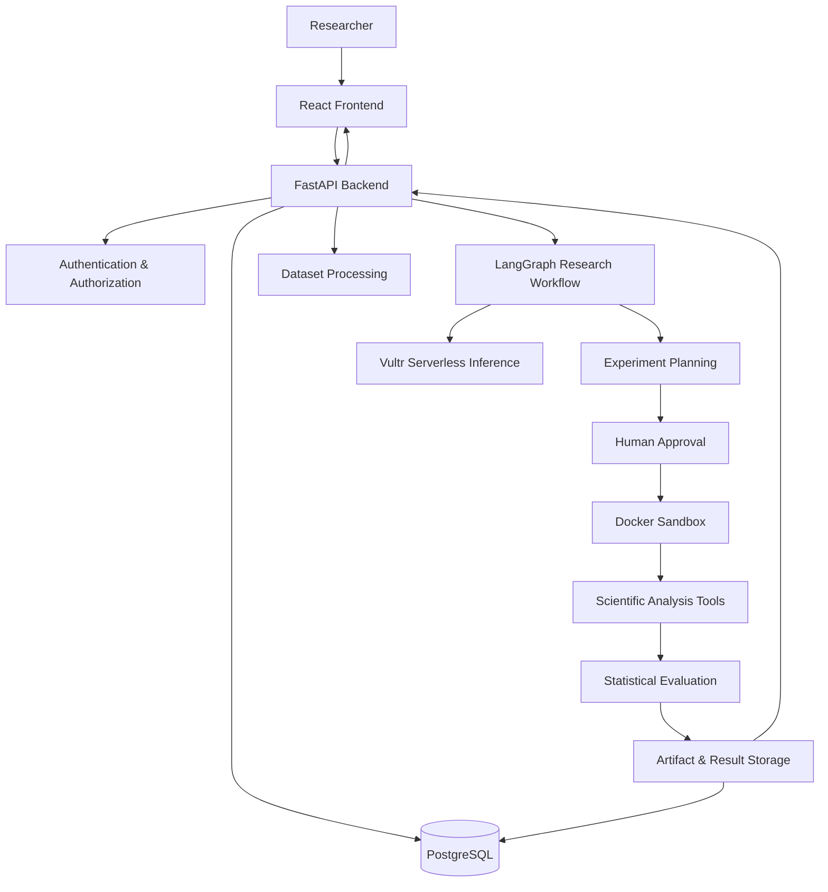

# NeuroForge AI
### Autonomous Scientific Discovery & Experimentation Platform

[](https://www.python.org/)
[](https://fastapi.tiangolo.com/)
[](https://react.dev/)
[](https://www.typescriptlang.org/)
[](https://www.docker.com/)
[](https://www.postgresql.org/)
[](https://www.langchain.com/langgraph)

**Live Application:** https://neuroforgeai.duckdns.org/
**API Documentation:** https://neuroforgeai.duckdns.org/docs
**Health Check:** https://neuroforgeai.duckdns.org/health
**Source Code:** https://github.com/EshemWaseem/NeuroForge-AI

---

## Overview

NeuroForge AI is an autonomous scientific discovery platform designed to help researchers move from raw datasets to structured, statistically evaluated research findings.

Instead of treating AI as a simple chatbot, NeuroForge AI organizes scientific analysis into a controlled research workflow. It combines dataset inspection, research hypothesis generation, experiment planning, isolated analytical execution, statistical evaluation, and evidence-backed reporting.

The platform initially focuses on cancer gene-expression and transcriptomic research datasets.

Its central design principle is:

> AI should help researchers explore scientific questions, but analytical execution must remain controlled, reproducible, and evidence-driven.

NeuroForge AI is a research-assistance platform. Its outputs are not medical diagnoses, clinical recommendations, or substitutes for expert scientific review.

## The Problem

Scientific experimentation often involves repetitive and disconnected steps:

- Inspecting unfamiliar datasets and understanding their structure.
- Identifying missing values, inconsistent columns, and data-quality issues.
- Developing research hypotheses from available observations.
- Designing experiments and selecting appropriate analytical methods.
- Executing code in a controlled environment.
- Evaluating results using statistical evidence.
- Converting experimental outputs into understandable research reports.

These steps can require substantial manual effort and technical knowledge.

AI-generated analysis introduces additional risks: unsupported conclusions, uncontrolled code execution, misleading statistical interpretations, and poor reproducibility.

NeuroForge AI addresses these challenges through a structured, tool-assisted research workflow with explicit execution boundaries.

## What NeuroForge AI Does

### 1. Dataset Inspection

Researchers can upload scientific datasets for structured inspection.

The platform's dataset-processing services support:

- Dataset parsing and structural inspection.
- Column and data-type analysis.
- Missing-value assessment.
- Dataset-quality checks.
- Preparation of structured information for downstream research workflows.

The initial research focus is cancer gene-expression and transcriptomic datasets.

### 2. AI-Assisted Hypothesis Generation

The research agent uses dataset context to help identify potential research directions.

It distinguishes between:

- **Observed facts:** Information directly supported by the dataset.
- **Detected patterns:** Patterns identified through analytical processing.
- **Research hypotheses:** Questions or explanations that require further investigation.

A hypothesis is not treated as a scientifically established conclusion.

### 3. Experiment Planning

The research workflow develops an analytical plan based on the research question and available dataset.

The plan can identify:

- Variables relevant to the research question.
- Potential analytical approaches.
- Statistical evaluation requirements.
- Expected experiment outputs.

### 4. Human Approval Before Execution

NeuroForge AI includes a human approval step in its research workflow.

This creates an execution boundary between AI-assisted planning and analytical code execution.

The intention is to prevent an AI-generated plan from automatically becoming unrestricted code execution.

### 5. Isolated Analytical Execution

A major engineering focus is restricting the environment in which analytical code runs.

NeuroForge AI uses Docker-based sandbox execution with multiple security controls:

| Control | Configuration |
|---|---|
| Network access | Disabled |
| Root filesystem | Read-only |
| Linux capabilities | Dropped |
| Privilege escalation | Disabled |
| Process limit | 64 |
| Memory limit | 1024 MB |
| CPU limit | 1 CPU |
| Temporary filesystem | Restricted `tmpfs` |
| Container user | Non-root UID 10001 |
| Container lifecycle | Automatically removed |
| Workspace | Dedicated mounted workspace |

Additional safeguards include:

- Execution time limits.
- Restricted workspace access.
- Artifact collection and validation.
- Workspace cleanup.
- Container cleanup after execution.

These controls reduce the impact of untrusted analytical code. They do not guarantee complete isolation from every host-level or infrastructure-level threat.

### 6. Statistical Evaluation

The platform includes a statistical analysis engine with methods such as:

- Welch's t-test.
- Benjamini-Hochberg false discovery rate correction.
- Hedges' g effect size.
- Principal Component Analysis (PCA).

These methods help assess differences, statistical significance, effect sizes, and dataset structure.

The appropriate statistical method depends on the dataset, research design, and assumptions. Statistical significance alone does not establish biological or clinical importance.

### 7. Findings and Research Reports

The platform organizes experiment outputs into research findings and reports.

This provides a structured way to review:

- Research questions and hypotheses.
- Experiment configuration.
- Analytical outputs.
- Statistical results.
- Supporting evidence.
- Generated artifacts.

The goal is to make the research process easier to inspect and review rather than presenting an unexplained AI-generated answer.

---

## System Architecture

NeuroForge AI follows a frontend/backend architecture with a separate database and isolated execution environment.



### Architecture Components

| Component | Responsibility |
|---|---|
| React frontend | Research workspace and user interface |
| FastAPI backend | API layer and application services |
| LangGraph | Structured research-agent workflow |
| Vultr Serverless Inference | LLM inference |
| PostgreSQL | Persistent application data |
| Docker sandbox | Restricted analytical code execution |
| Scientific analysis services | Dataset processing and statistical evaluation |

## Research Workflow

The research workflow is organized around these stages:

1. **Dataset Inspection** — Parse and inspect the uploaded dataset.
2. **Hypothesis Generation** — Identify possible research questions.
3. **Experiment Planning** — Develop an analytical execution plan.
4. **Human Approval** — Review the proposed plan before execution.
5. **Sandbox Execution** — Run approved analytical work in a restricted Docker environment.
6. **Evaluation and Reporting** — Evaluate results and organize findings.

This separates AI-assisted reasoning from analytical execution and result evaluation.

## Technology Stack

### Frontend

- React 18
- TypeScript
- Vite
- Tailwind CSS
- Axios
- React Router
- Lucide React

### Backend

- Python
- FastAPI
- Pydantic
- Uvicorn
- Pytest
- HTTPX

### AI and Agent Workflow

- LangGraph
- Vultr Serverless Inference
- DeepSeek model inference

### Data and Infrastructure

- PostgreSQL 16
- Docker
- Docker Compose
- Ubuntu 24.04
- Vultr Cloud Infrastructure
- Nginx
- Let's Encrypt SSL

---

## Security Engineering

Security is a core design consideration because the platform executes analytical workloads generated through an AI-assisted workflow.

### Sandbox Isolation

The analytical execution environment applies defense-in-depth controls, including:

- Network isolation.
- Read-only root filesystem.
- Non-root execution.
- Dropped Linux capabilities.
- Disabled privilege escalation.
- CPU, memory, and process limits.
- Restricted temporary storage.
- Dedicated workspaces.
- Automatic container cleanup.

### Artifact Handling

Generated artifacts are subject to validation and resource limits.

The application applies safeguards for artifact collection, including path and symlink handling, to reduce the risk of accessing files outside the permitted workspace.

### Important Infrastructure Limitation

The backend requires access to the Docker daemon to create and manage sandbox containers. Access to the Docker socket is highly privileged and can create host-level risk if the backend is compromised.

Docker containers also share the host operating-system kernel.

Therefore, NeuroForge AI uses layered containment controls, but does not claim that Docker provides an absolute security boundary or guarantees zero blast radius.

Production deployments should additionally use strict access controls, host hardening, monitoring, regular patching, backups, and an appropriate threat model.

---

## Deployment

The live application is deployed on Vultr infrastructure.

**Production URL:** https://neuroforgeai.duckdns.org/

The production environment uses:

- Ubuntu 24.04.
- Docker-based application services.
- PostgreSQL.
- Nginx reverse proxy.
- HTTPS with Let's Encrypt.
- Vultr Serverless Inference integration.

### Production Services

The deployment separates the application into frontend, backend, and database services.

| Service | Purpose |
|---|---|
| Frontend | Serves the React application |
| Backend | Runs the FastAPI application |
| Database | Stores persistent application data |

The database is not intended to be exposed directly to the public internet.

### Health Check

The backend health endpoint is available at:

https://neuroforgeai.duckdns.org/health

### API Documentation

Interactive API documentation:

https://neuroforgeai.duckdns.org/docs

---

## Repository Structure

```text
NeuroForge-AI/
│
├── artifacts/
│
├── backend/
│   ├── app/
│   │   ├── api/
│   │   │   └── routers/
│   │   ├── core/
│   │   ├── db/
│   │   ├── schemas/
│   │   └── services/
│   │       ├── dataset_parser.py
│   │       ├── dataset_quality.py
│   │       ├── research_graph.py
│   │       ├── sandbox.py
│   │       ├── scientific_tools.py
│   │       ├── statistical_engine.py
│   │       ├── storage.py
│   │       └── vultr_inference.py
│   │
│   ├── tests/
│   ├── Dockerfile
│   └── requirements.txt
│
├── data/
│
├── docker/
│
├── docs/
│
├── frontend/
│   └── src/
│       ├── components/
│       ├── context/
│       ├── pages/
│       │   ├── app/
│       │   └── public/
│       ├── services/
│       └── types/
│
├── infrastructure/
│
├── .env.example
├── .gitignore
├── AGENTS.md
├── docker-compose.yml
├── docker-compose.prod.yml
└── README.md
```

---

## Getting Started

### Prerequisites

Install the following tools before starting:

- Python 3.11 or a compatible version supported by the backend dependencies.
- Node.js and npm.
- Docker Engine or Docker Desktop.
- Git.
- PostgreSQL, if running the database outside Docker.

### 1. Clone the Repository

```bash
git clone https://github.com/EshemWaseem/NeuroForge-AI.git
cd NeuroForge-AI
```

### 2. Configure Environment Variables

Use the example environment file as a starting point:

```bash
cp .env.example .env
```

Configure the required application, database, authentication, inference, and sandbox settings.

Never commit actual API keys, passwords, signing secrets, or production environment files.

### 3. Start the Application

Review the Docker Compose configuration and required environment variables before starting the services.

For the local development configuration:

```bash
docker compose up --build
```

Check the Compose service configuration and application logs if a service does not start.

### 4. Access the Application

The frontend and backend addresses depend on the ports configured in your local environment.

For production, use:

- Application: https://neuroforgeai.duckdns.org/
- API documentation: https://neuroforgeai.duckdns.org/docs

---

## Engineering Principles

NeuroForge AI is built around several engineering principles:

**1. Separation of concerns**

The frontend, API, research workflow, statistical services, database, and execution environment have distinct responsibilities.

**2. Controlled autonomy**

AI can assist with research reasoning and experiment planning, while analytical execution is separated through an approval boundary.

**3. Evidence-driven outputs**

Research findings should be connected to analytical outputs rather than presented as unsupported AI conclusions.

**4. Defense in depth**

Sandbox restrictions use multiple controls instead of relying on a single security mechanism.

**5. Reproducibility and reviewability**

Structured experiment outputs and artifacts make it easier to inspect what happened during an analysis.

**6. Practical deployment**

The project is deployed on real cloud infrastructure rather than existing only as a local prototype.

---

## Current Scope and Limitations

NeuroForge AI is an evolving research platform.

Current scope and limitations include:

- Initial focus on cancer gene-expression and transcriptomic datasets.
- Statistical outputs require appropriate research-design and assumption checks.
- AI-generated hypotheses require expert scientific review.
- Sandbox isolation reduces risk but is not equivalent to a separate virtual machine or dedicated execution host.
- LLM output quality depends on the selected model, prompt, dataset context, and inference availability.
- The platform is not validated for clinical or diagnostic use.

---

## Team

### Muhammad Eshem Waseem

**AI Engineer and Full Stack Developer**

Interests: Artificial Intelligence, Machine Learning, Generative AI, Agentic AI, LLM Applications, RAG, Python, and Backend Engineering.

- GitHub: https://github.com/EshemWaseem
- LinkedIn: https://www.linkedin.com/in/muhammad-eshem-waseem/

### Bakhtawar Tasawar

**Bioinformatics**

- LinkedIn: https://www.linkedin.com/in/bakhtawartasawar/

---

## Hackathon

**Vultr Agent Rush — Challenge 1: Blast Radius Zero**

NeuroForge AI explores how autonomous AI research workflows can be combined with controlled execution environments, statistical evaluation, and practical cloud deployment.

The project emphasizes a key engineering challenge: enabling useful AI-driven experimentation while limiting the operational risks associated with executing generated analytical code.

---

## Disclaimer

NeuroForge AI is intended for research and educational purposes.

It does not provide medical advice, diagnosis, treatment recommendations, or clinically validated conclusions. All scientific findings and statistical interpretations should be reviewed by qualified researchers.

---

## License

No open-source license has currently been granted unless a separate license file is included in this repository.

All rights remain with the respective copyright holders. Do not assume permission to reuse, distribute, or modify this project without authorization.
